# EPIC 96 — AUTOMATED PERIODIC UPDATES & SCHEDULER GOVERNANCE
## Execution Matrix, Quota Safety Budget & Decoupled Architecture
### Timestamp: 2026-11-03T04:15:00+07:00 | Runtime: Cloud Run / Vercel / Cloud Scheduler

---

## 1. Current Scheduler State: Production Cron is PAUSED

A forensic audit of deployment configurations confirms:
- **`SALMO/vercel.json`**: `"crons": []` (Strictly empty array, 0 automated jobs active).
- **`HandicapLab/vercel.json`**: Only rewrites to Cloud Run (`https://handicaplab-production-129269713730.asia-southeast2.run.app`).
- **Google Cloud Scheduler (`asia-southeast2`)**:
  - `handicaplab-pipeline-daily`: **`PAUSED`** (Verified via `gcloud scheduler jobs list`).
  - `handicaplab-rescue-daily`: **`PAUSED`** (Verified via `gcloud scheduler jobs list`).

### Current Operational Fact
**No automatic cron job is currently executing in production.** The system is completely safe from runaway API consumption, concurrent collisions, or unauthorized quota depletion.

---

## 2. Eleven Decoupled Logical Jobs Architecture

To prevent a single failure or quota block from cascading across the system, the 11 operational tasks are decoupled into discrete, isolated pipelines:

| # | Logical Job | Execution Trigger | Frequency | Data Provider | Provider Cost | Current Status |
|---|---|---|---|---|---|---|
| **1** | **Fixture Discovery** | Supabase DB / OpenFootball | Daily (01:00 UTC) | Local DB / Open Source | **$0** | Implemented (Requires mapping fix) |
| **2** | **Fixture Normalization** | Internal Service | Daily (01:15 UTC) | Internal | **$0** | Implemented |
| **3** | **Odds Discovery (Pinnacle)** | Tournament Batch RPC | 1x Daily (04:00 UTC) | OddsPapi Free | **1-3 requests** | Implemented |
| **4** | **Prematch Odds Refresh** | Tournament Batch RPC | Matchdays (10:00 UTC) | OddsPapi Free | **1 request** | Implemented |
| **5** | **Prediction Generation** | Dixon-Coles Engine | Daily (04:30 UTC) | Internal DB | **$0** | Implemented |
| **6** | **Match Status Sync** | Match Status Watcher | Every 2h on Matchday | OpenFootball / DB | **$0** | Implemented |
| **7** | **Final Result Sync** | FreeResultsAdapter | Every 4h on Matchday | football-data.co.uk | **$0** | Implemented |
| **8** | **Position Settlement** | Settlement Worker | Post-Match (22:00 UTC) | Supabase DB | **$0** | Implemented & Verified |
| **9** | **Ledger Reconciliation** | Audit RPC | Daily (23:00 UTC) | Internal DB | **$0** | Implemented |
| **10** | **Data Quality Monitor** | Sanity Validator | Daily (00:00 UTC) | Internal DB | **$0** | Implemented |
| **11** | **Quota Monitor & Alert** | Quota Allocator | Realtime on RPC | OddsPapi / DB | **$0** (Unmetered) | Implemented & Verified |

---

## 3. Proposed Production Activation Schedule (When Approved)

```mermaid
flowchart TD
    subgraph Morning ["Morning Run (04:00 UTC / 11:00 WIB)"]
        J1["1. Load Fixtures from DB ($0)"] --> J2["2. Fetch Tier A Batch Odds (1 req)"]
        J2 --> J3["3. Generate Predictions ($0)"]
        J3 --> J4["4. Publish Daily Picks ($0)"]
    end
    
    subgraph Matchday ["Matchday Prematch (10:00 UTC / 17:00 WIB)"]
        J5["5. Final Prematch Refresh (1 req)"] --> J6["6. Update Edges & Filter Layak"]
    end
    
    subgraph Evening ["Evening Settlement (22:00 UTC / 05:00 WIB next day)"]
        J7["7. Sync Final Scores ($0)"] --> J8["8. Settle Eligible Picks ($0)"]
        J8 --> J9["9. Reconcile Ledger & P&L ($0)"]
    end
```

### Safety Controls for Activation
1. **Distributed Concurrency Lease**:
   `DistributedCronLease` prevents concurrent overlapping cron runs using 5-minute database leases.
2. **Quota Circuit Breaker**:
   If remaining quota reaches $\le 50$, the scheduler halts all odds requests and switches to read-only cached serving.
3. **Rollback Seam**:
   A single environment variable toggle (`ODDSPAPI_PAUSED=true` or `ENABLE_PRODUCTION_CRON=false`) immediately stops all outbound requests.
