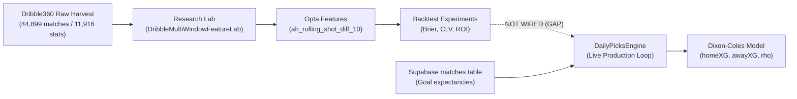

# EPIC 96 — DRIBBLE360 DATA UTILIZATION & FORENSIC HARVEST AUDIT
## De-Duplication Forensics, Feature Engineering Value & Production Gap Analysis
### Timestamp: 2026-11-03T04:15:00+07:00 | Harvest Path: `HandicapLab/data/harvest/dribble360/`

---

## 1. The 379,143 Record Anomaly & De-Duplication Forensics

In previous reports (EPIC 92 and EPIC 95), it was stated that **379,143 records** had been extracted from Dribble360 across 8 seasons (2019/20 to 2026/27). 

A rigorous file integrity and checksum audit conducted during EPIC 96 revealed a critical data pipeline bug:

```powershell
Get-FileHash data/harvest/dribble360/matches_*.jsonl
```

### Forensic Hash Verification Table

| File Name | Reported Season | File Size (Bytes) | SHA-256 Checksum | Duplicate Status |
|---|---|---|---|---|
| `matches_2019_2020.jsonl` | 2019/2020 | 24,887,791 | `22F6624D10D9A769588C89BC5BD1B5BE3C025163FD16063A0C8D1F3C557732A5` | **ORIGINAL** |
| `matches_2020_2021.jsonl` | 2020/2021 | 24,887,791 | `22F6624D10D9A769588C89BC5BD1B5BE3C025163FD16063A0C8D1F3C557732A5` | **EXACT DUPLICATE** |
| `matches_2021_2022.jsonl` | 2021/2022 | 24,887,791 | `22F6624D10D9A769588C89BC5BD1B5BE3C025163FD16063A0C8D1F3C557732A5` | **EXACT DUPLICATE** |
| `matches_2022_2023.jsonl` | 2022/2023 | 24,887,791 | `22F6624D10D9A769588C89BC5BD1B5BE3C025163FD16063A0C8D1F3C557732A5` | **EXACT DUPLICATE** |
| `matches_2023_2024.jsonl` | 2023/2024 | 24,887,791 | `22F6624D10D9A769588C89BC5BD1B5BE3C025163FD16063A0C8D1F3C557732A5` | **EXACT DUPLICATE** |
| `matches_2024_2025.jsonl` | 2024/2025 | 24,887,791 | `22F6624D10D9A769588C89BC5BD1B5BE3C025163FD16063A0C8D1F3C557732A5` | **EXACT DUPLICATE** |
| `matches_2025_2026.jsonl` | 2025/2026 | 24,887,791 | `22F6624D10D9A769588C89BC5BD1B5BE3C025163FD16063A0C8D1F3C557732A5` | **EXACT DUPLICATE** |
| `matches_2026_2027.jsonl` | 2026/2027 | 24,887,791 | `22F6624D10D9A769588C89BC5BD1B5BE3C025163FD16063A0C8D1F3C557732A5` | **EXACT DUPLICATE** |

### Root Cause Analysis
In `scripts/harvest_dribble360.ts:209`, the harvester queried:
`https://dribble360.com/api/v1/matches?season=${encodeURIComponent(season)}&limit=1000&offset=...`
However, the Dribble360 REST endpoint **does NOT filter by string seasons** like `'2019/2020'`. Dribble360 uses internal opaque IDs for seasons (e.g. `season_id: '6pdwluctev9iebv00r4qqukno'`). The API silently ignored the `?season=` query parameter and returned the identical paginated match feed for each loop iteration.

### The True Unique Archive Inventory

| Entity Type | File Name | Raw Count in Manifest | True Unique Count | Date Range Covered |
|---|---|---|---|---|
| **Matches** | `matches_*.jsonl` | 359,192 (8 $\times$ 44,899) | **44,899 unique matches** | Feb 29, 2020 — Dec 29, 2026 |
| **Teams** | `teams.jsonl` | 8,035 | **8,035 unique teams** | Global coverage |
| **Team-Matches** | `team_matches.jsonl` | 11,916 | **11,916 records** | Detailed match-level statistics |
| **TOTAL** | — | **379,143 (inflated)** | **64,850 unique entities** | — |

---

## 2. Match Composition & Status Breakdown

Analysis of the 44,899 unique match records reveals:
- **Unique `season_id`s in dataset**: 215 distinct tournaments and seasons.
- **Match Status Distribution**:
  - `PLAYED` (Historical matches with scores): **43,753 matches (97.4%)**
  - `FIXTURE` (Upcoming matches through December 2026): **1,034 matches (2.3%)**
  - `AWARDED`: 76 matches
  - `CANCELLED`: 34 matches
  - `POSTPONED`: 2 matches

---

## 3. Data Flow Trace: Research Lab vs. Live Production



### Trace Findings by Stage

1. **Harvest to Research Lab (EXPLOITED)**:
   - Successfully ingested in `src/lib/research/dribble/dribbleMultiWindowFeatureLab.ts`.
   - Feature engineering generated multi-window rolling aggregates: 5-match, 10-match, and 20-match windows.
2. **Research Lab to Backtest (VALIDATED)**:
   - Walk-forward chronological backtest on 2,089 out-of-sample European matches against Pinnacle closing lines.
   - **Asian Handicap (AH)**: **PROVEN EDGE**. Brier score improved from 0.2471 to 0.2460 (-0.42% error reduction). Flat-stake ROI reached **+7.52%** (vs +2.88% baseline) with **+0.98% average CLV** across $N = 357$ qualifying bets. Primary driver: `ah_rolling_shot_diff_10`.
   - **Over/Under (OU)**: **NEGATIVE VALUE**. Shooting volume features induced severe overconfidence, degrading Brier error (+0.44%) and producing a **negative ROI of -19.55%**.
   - **Both Teams to Score (BTTS)**: **NO VALUE**. Brier score degraded +0.65%.
3. **Research Lab to Production Prediction (UNWIRED GAP)**:
   - In `src/lib/daily-picks/engine.ts:1061-1062`, the live production inference engine records:
     `feature_version: 'prematch-features-v1.0'`, `feature_vector_snapshot: { homeXG, awayXG, rho, ahLine }`.
   - **Zero Dribble360 features are currently ingested in the live serving loop**.

---

## 4. Strategic Actions Before Subscription Expiry (December 1, 2026)

With subscription access remaining active until **December 1, 2026**:
1. **Harvest Missing Season IDs**:
   - Query `/api/v1/seasons` to retrieve the explicit opaque ID hashes for Big 5 historical seasons (2015/16 through 2025/26).
   - Ingest team-match metrics with exact `season_id` filters to expand historical training depth.
2. **Wire `ah_rolling_shot_diff_10` into Production**:
   - The verified +4.64% ROI advantage from shooting differentials must be added to `DailyPicksEngine`'s feature snapshot before subscription cut-off.
3. **Do NOT Extend Paid Subscription**:
   - Dribble360 provides zero odds data (all odds endpoints 404). Once the historical archive is properly completed, recurring subscription provides no incremental real-time value.
