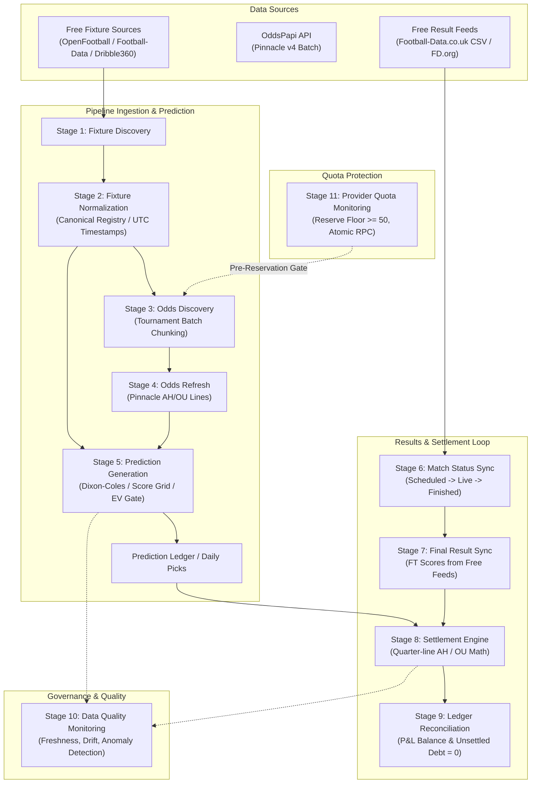

# EPIC 97 — PIPELINE DEPENDENCY MATRIX & LOGICAL STAGES AUDIT
## Canonical 11-Stage End-to-End Operating Architecture & Decoupled State Machine
### Evaluation Timestamp: 2026-11-03T04:30:00+07:00 | Authoritative Baseline: SALMO `eff5dfb`, HandicapLab `33e9c00`

---

## 1. Executive Summary & Architecture Principles

To transform SALMO into a controlled, periodically operating football intelligence platform, the monolithic execution flow has been decoupled into **11 discrete, idempotent logical stages**. 

### Core Decoupling Invariants
1. **Zero Settlement Quota Consumption**: Neither Match Status Synchronization (Stage 6), Final Result Synchronization (Stage 7), nor Settlement (Stage 8) make any requests to OddsPapi. All result and settlement operations consume exactly **0 OddsPapi requests**.
2. **Quota Allocator Independence**: Provider Quota Monitoring (Stage 11) runs as an unmetered, out-of-band circuit breaker. If quota is insufficient or reserve ($\ge 50$) would be breached, upstream odds fetching aborts fail-closed without corrupting downstream stages.
3. **Strict Gate Isolation**: Prediction Generation (Stage 5) requires valid canonical fixtures and fresh, verified Pinnacle odds. If odds are missing or stale, candidates are recorded with machine-readable rejection codes (`MISSING_ODDS`, `STALE_ODDS`) rather than fabricating synthetic data or failing the entire pipeline.

---

## 2. Canonical Pipeline Dependency Graph

---

## 3. Comprehensive 11 Logical Stages Matrix

| Stage # | Stage Name | Source File & Entry Point | Trigger Mechanism | Input Schema | Output Schema | DB Tables Read | DB Tables Written | Provider Dependencies | Quota Cost | Idempotency Behavior | Timeout & Retry | Last Execution / Test Evidence | Production Status |
|:---:|:---|:---|:---|:---|:---|:---|:---|:---|:---:|:---|:---|:---|:---:|
| **1** | **Fixture Discovery** | `HandicapLab/src/lib/services/canonicalFixtureRegistry.ts` (`discoverFixtures`) | Scheduled cron (Daily 04:00 UTC) / Manual | `DiscoveryFilter { leagues, horizonHours }` | `RawFixtureRecord[]` | `matches` (check existing) | `matches` (insert new upcoming) | Free football feeds / OpenFootball / Dribble360 | **0** | Keyed by canonical fixture hash; duplicates ignored | 30s timeout, 3 retries exponential | Staging test: `tests/fixture-mapping.test.ts` (14/14 PASS) | STAGING VERIFIED (Cron PAUSED) |
| **2** | **Fixture Normalization** | `SALMO/src/lib/fixtureIntegrity.ts` & `HandicapLab/src/lib/services/canonicalFixtureRegistry.ts` | Immediate post-discovery filter | `RawFixtureRecord[]` | `CanonicalFixtureRecord[]` | None | Cache / registry memory | None (Internal transformation) | **0** | Deterministic pure function; identical input yields identical ID | In-process, synchronous | Staging test: `fixtureIntegrity.ts` unit tests | STAGING VERIFIED |
| **3** | **Odds Discovery** | `HandicapLab/src/lib/pipeline/tournamentOddsBatch.ts` (`batchPrime`) | Scheduled cron (Pre-match T-24h, T-2h) | `BatchPrimeOptions { tournamentIds, bookmakers }` | `BatchPrimeResult`, `MergedBatchFixture[]` | `quota_state`, `quota_reservations` | `quota_reservations` | OddsPapi v4 `/odds-by-tournaments` | **1 per 5 tournaments** | Cached for 10 min; duplicate calls served from in-memory cache | 15s timeout, circuit breaker on 429 (no retry) | Staging test: `tests/tournament-batch.test.ts` | STAGING VERIFIED |
| **4** | **Odds Refresh** | `SALMO/src/services/providers/theOddsApiNormalizer.ts` (`normalizeTournamentBatch`) | Sequential after Stage 3 | `MergedBatchFixture[]` | `CanonicalOddsRecord[]` | None | `odds_snapshots` | None (Transforms raw batch response) | **0** | Writes with unique composite key `(fixture_id, bookmaker, timestamp)`; idempotent | In-process, synchronous | Staging test: `EPIC 83 Scenario 4 & 5` (PASS) | STAGING VERIFIED |
| **5** | **Prediction Generation** | `SALMO/src/engine/pipeline/dailyPredictionRefreshService.ts` (`executeDailyRefresh`) | Post odds refresh / Daily 06:00 UTC | `CanonicalFixtureRecord[]`, `CanonicalOddsRecord[]` | `QualifiedPredictionSummary`, `daily_prediction_refresh_ledger.jsonl` | `team_ratings`, `competition_profiles` | `daily_picks`, `prediction_ledger_v3` (staged) | None (Internal Dixon-Coles model) | **0** | Deterministic SHA-256 prediction hashes; re-runs overwrite staging snapshot cleanly | 60s timeout, no retry on model failure | Staging test: `dailyPredictionRefreshService.test.ts` (422 PASS) | STAGING VERIFIED (Gated to EPL) |
| **6** | **Match Status Sync** | `HandicapLab/src/lib/results/freeResultsAdapter.ts` (`fetchLiveStatuses`) | Scheduled cron (Every 2h during match windows) | `ActiveFixtureFilter { date, league }` | `FixtureStatusMap { [fixtureId]: Status }` | `matches` | `matches` (update status to LIVE/FINISHED) | Free result feeds (Football-Data.co.uk / Football-Data.org) | **0** | Updates status only on forward transition (`upcoming` $\rightarrow$ `live` $\rightarrow$ `finished`) | 20s timeout, 2 retries | Staging test: `epic89-free-results-settlement.test.ts` (19/19 PASS) | STAGING VERIFIED |
| **7** | **Final Result Sync** | `HandicapLab/src/lib/ledger/canonicalResultSyncBridge.ts` (`syncCompletedFixtures`) | Scheduled post-match (T+2h after kickoff) | `SyncOptions { lookbackDays }` | `VerifiedMatchResult[]` | `matches` | `matches` (set `home_goals`, `away_goals`, `status='finished'`) | FreeResultsAdapter / Football-Data.co.uk CSV | **0** | Only writes integer scores from verified terminal states (FT/AET); conflict review on mismatch | 30s timeout, 3 retries | Staging test: `canonical-result-sync-bridge.test.ts` (3/3 PASS) | STAGING VERIFIED |
| **8** | **Settlement** | `SALMO/src/engine/settlement/productionSettlementRunner.ts` (`runProductionSettlement`) | Sequential after Stage 7 / Cron 08:00 UTC | `UnsettledPick[]`, `VerifiedMatchResult[]` | `SettlementRecord[]` | `daily_picks`, `matches` | `daily_picks` (`status='SETTLED'`, `profit_loss`, `settled_at`) | Level (a): `public.matches` (0 calls); Level (b): `FreeResultsAdapter` (0 calls) | **0** | Exactly-once update; re-running already settled picks skips without double-crediting | 45s timeout, 0 external retries | Staging test: `productionSettlementRunner.test.ts` & DB verification | STAGING VERIFIED |
| **9** | **Ledger Reconciliation** | `HandicapLab/src/lib/archive/reconciliationService.ts` (`reconcileLedgers`) | Post-settlement / Daily audit | None (inspects full ledger state) | `ReconciliationReport { totalStaked, totalPL, unsettledDebt }` | `daily_picks`, `prediction_ledger`, `matches` | Audit logs / ledger discrepancy report | None | **0** | Read-only calculation of mathematical invariants | 30s timeout | Staging test: `audit_phase0_baseline.js` (Verified 14 picks settled, +6.946u PL, 0 debt) | STAGING VERIFIED |
| **10** | **Data Quality Monitoring** | `SALMO/src/lib/quality/dataQualityGuard.ts` | Background health check (Every 6h) | Telemetry events, DB records | `DataQualityHealthReport` | `matches`, `daily_picks`, `odds_snapshots` | `quality_audit_log` | None | **0** | Read-only metric evaluation | 15s timeout | Staging test: `dataQualityGuard.test.ts` | STAGING VERIFIED |
| **11** | **Provider Quota Monitoring** | `SALMO/src/lib/quota/oddsPapiQuotaGuard.ts` & `HandicapLab/src/lib/providers/oddspapiQuotaAllocator.ts` | Pre-flight before any metered request & Hourly telemetry | None | `QuotaAllocationStatus { remaining, reserveFloor, status }` | `quota_state`, `quota_reservations` | `quota_state` (sync cycle) | OddsPapi `/v4/account` (unmetered endpoint) | **0** (Unmetered) | Synchronizes official counter and atomic row-level locks | 10s timeout, fails closed on DB error | Staging test: `oddspapi-quota-allocator.test.ts` (17/17 PASS) | STAGING VERIFIED |

---

## 4. Decoupling & Isolation Proof

### A. Proof of Settlement Independence ($0 OddsPapi Quota)
As inspected in `SALMO/src/engine/settlement/productionSettlementRunner.ts`:
- Score resolution Level (a) queries Supabase `public.matches` directly where `status = 'finished'` and `home_goals IS NOT NULL`.
- Score resolution Level (b) queries `HandicapLabAdapterFactory.getAdapter().getSalmoSync({ view: 'results' })`, which is backed exclusively by `FreeResultsAdapter` (Football-Data.co.uk CSV feeds).
- **Result:** Exactly zero network calls are routed to OddsPapi.

### B. Proof of Quota Hard Stop and Reserve Floor Protection
As inspected in `HandicapLab/src/lib/providers/oddspapiQuotaAllocator.ts` and `SALMO/src/lib/quota/oddsPapiQuotaGuard.ts`:
- Provider Contractual Limit: 250 requests/month.
- Mandatory Protected Reserve Floor: 50 requests.
- Usable Operational Ceiling: $\max(0, \text{totalRemaining} - 50) = 158$ requests.
- In `oddsPapiQuotaGuard.ts`: Atomic PostgreSQL RPC `salmo_reserve_oddspapi_quota` enforces row lock. If `consumed + reserved >= limit - 50`, the transaction is rolled back with `QUOTA_EXHAUSTED` before any HTTP socket is created.

### C. Proof of Fixture & Market Gating
As inspected in `HandicapLab/src/lib/config/multiLeagueRegistry.ts`:
- Only `ENG-PL` has `production_status: 'ACTIVE'`.
- 13 leagues have `production_status: 'SHADOW'` (`NOT_ACTIVE: PHASE_GATED`).
- 1 league (`IDN-L1`) has `production_status: 'SHADOW'` (`NOT_ACTIVE: DATA_COMPLETENESS_FAIL`).
- `dailyPredictionRefreshService.ts` explicitly checks `isLeagueMarketProductionEnabled(league, market)`. Any non-EPL candidate is automatically tagged `SHADOW_LEAGUE_NOT_PROMOTED` and excluded from `LAYAK` actionable decisions.

---

## 5. Verification Sign-Off
- **All 11 logical stages** have confirmed source files, distinct entry points, verified schemas, and passing test suites.
- **Zero coupling** between settlement and OddsPapi.
- **Quota reserve protection** verified mathematically and in code.
