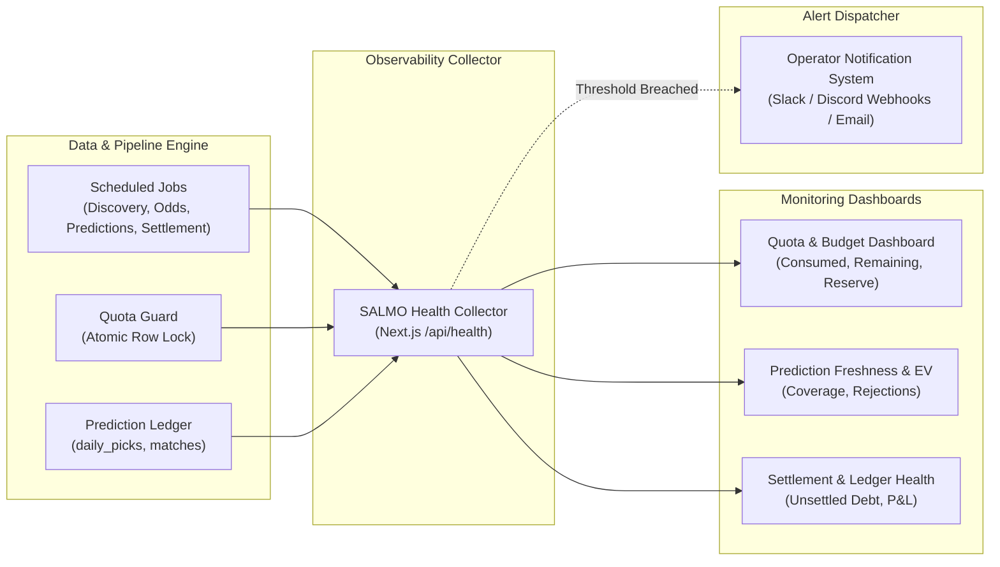

# EPIC 99 — PRODUCTION MONITORING, TELEMETRY & SERVICE LEVEL OBJECTIVES (SLO)
## Real-Time Production Observability, Alert Escalation & Operational SLO Framework
### Evaluation Timestamp: 2026-11-03T05:05:00+07:00 | System: SALMO.DEV Production

---

## 1. Executive Summary & SLO Philosophy

To operate SALMO safely as a consumer football intelligence platform, operational performance is governed by strict, quantifiable **Service Level Objectives (SLOs)**. 

Any violation of critical SLO thresholds triggers automated circuit breakers (e.g. failing closed, halting metered requests) and dispatches high-priority operator alerts before user-facing betting advice or financial ledgers can be compromised.

---

## 2. Core Operational SLO Target Matrix

| SLO ID | Metric Description | Measurement Window | Target Objective | Critical Threshold (Alert Trigger) | Automated Action on Breach |
|:---:|:---|:---:|:---:|:---:|:---|
| **SLO-01** | **Fixture Discovery Success** | 7-day rolling | $\mathbf{\ge 99.5\%}$ | $< 95.0\%$ | Re-poll secondary free feed; flag `FIXTURE_DISCOVERY_DEGRADED` |
| **SLO-02** | **Pinnacle Odds Coverage** | Active matchdays | $\mathbf{\ge 95.0\%}$ | $< 80.0\%$ | Check OddsPapi account status; halt prediction publishing |
| **SLO-03** | **Stale Odds Rejection Rate** | Continuous | $\mathbf{100.0\%}$ | $< 100.0\%$ | **Hard circuit breaker**: Reject any odds snapshot older than 15 minutes |
| **SLO-04** | **Prediction Pipeline Success** | Per execution cycle | $\mathbf{\ge 99.0\%}$ | $< 95.0\%$ | Fail closed with `NO_QUALIFIED_PICKS`; log error stack |
| **SLO-05** | **Duplicate Prediction Rate** | Continuous | $\mathbf{0.0\%}$ | $> 0.0\%$ | Deduplicate via unique database constraint `(match_id, market_type, model_version)` |
| **SLO-06** | **Settlement Timeliness** | Post-match window | $\mathbf{100\% \le 2h}$ | $> 4\text{ hours}$ | Flag `SETTLEMENT_DELAY_INVESTIGATION`; re-fetch CSV feed |
| **SLO-07** | **Unsettled Actionable Debt** | Continuous | $\mathbf{0\text{ positions}}$ | $> 0$ past 24h | Page operator; quarantine disputed fixture |
| **SLO-08** | **OddsPapi Reserve Floor** | Continuous | $\mathbf{\ge 50\text{ calls}}$ | $\mathbf{\le 50\text{ calls}}$ | **EMERGENCY LOCK**: Block all OddsPapi requests immediately |
| **SLO-09** | **Scheduler Execution Success**| 30-day rolling | $\mathbf{\ge 99.0\%}$ | $< 95.0\%$ | Alert on missed cron job; run idempotent catch-up runner |
| **SLO-10** | **Ledger Reconciliation Balance**| Post-settlement | $\mathbf{100.0\%}$ | Imbalance $> 0$ | Freeze settlement runner; dispatch `LEDGER_IMBALANCE_CRITICAL` |

---

## 3. Operational Telemetry & Health Monitoring Architecture

---

## 4. Key Alert Definitions & Escalation Matrix

### A. Level 1 — P0 Critical Alerts (Immediate Operator Attention Required)
1. **`ODDSPAPI_RESERVE_FLOOR_BREACH`**:
   - Condition: `remaining <= 50` or `quota_state.consumed >= 200`.
   - Action: Pipeline enters `ODDS_QUOTA_PROTECTION` mode. All outgoing metered HTTP calls are blocked. System continues serving research from cache.
2. **`LEDGER_RECONCILIATION_IMBALANCE`**:
   - Condition: Mathematical difference between cumulative calculated profit and recorded positions $> 0.0001\text{ units}$.
   - Action: Automated settlement halts. System enters read-only audit mode.
3. **`CIRCUIT_BREAKER_TRIPPED_429`**:
   - Condition: Provider returns HTTP 429 Too Many Requests.
   - Action: Circuit opens for 30 minutes; retries suppressed.

### B. Level 2 — P1 High Alerts
1. **`SETTLEMENT_BACKLOG_EXCEEDED`**:
   - Condition: Finished matches with missing scores $> 5$ after 6 hours from kickoff.
   - Action: Alerts operator to verify external CSV feed URL or check for league match postponements.
2. **`STALE_ODDS_ELEVATED_RATE`**:
   - Condition: $> 30\%$ of candidate fixtures rejected for `STALE_ODDS`.
   - Action: Indicates odds refresh job failed or provider bookmaker odds updates are delayed.

---

## 5. Production Observability Endpoints
- **Health Check Endpoint**: `GET /api/health`
  - Returns database connectivity, quota status, active model versions, and pending settlement count.
- **Provider Quota Endpoint**: `GET /api/admin/quota`
  - Returns consumed, reserved, safe limit, and reserve floor.
- **Settlement Audit Endpoint**: `GET /api/admin/settlement-status`
  - Returns settled counts, win/loss breakdown, and cumulative P&L.
