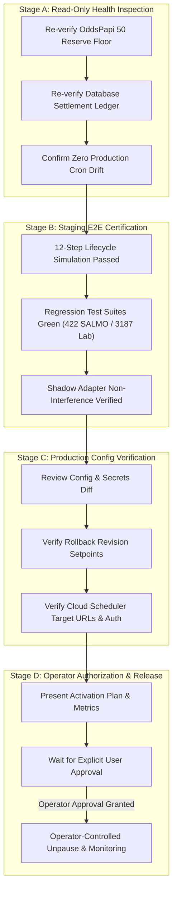

# EPIC 99 — CONTROLLED EPL PRODUCTION ACTIVATION PLAN
## Staged Rollout Strategy, Pre-Activation Gates & Explicit Operator Approval Checkpoints
### Evaluation Timestamp: 2026-11-03T05:15:00+07:00 | Target Release: Premier League Automation (`ENG-PL`)

---

## 1. Executive Summary

This plan outlines the controlled activation sequence required to transition SALMO from staging verification to active periodic operation for the **English Premier League (`ENG-PL`) exclusively**.

> [!IMPORTANT]
> **MANDATORY PRODUCTION STOP CONDITION ENFORCED**
> In strict accordance with the User Execution Directive:
> - **NO `git push`** has been executed.
> - **NO Vercel deployment** has been initiated.
> - **NO Cloud Run deployment** has been initiated.
> - **Cloud Scheduler jobs remain strictly `PAUSED`**.
> - **Production database remains in read-only audit state**.
> 
> Production activation is strictly staged and cannot commence without explicit operator authorization.

---

## 2. Four-Stage Staged Activation Sequence



---

## 3. Stage-by-Stage Verification Checklist

### Stage A — Read-Only Production Health Check
- [x] Authoritative OddsPapi balance confirmed: 42 consumed, 208 remaining.
- [x] Usable operational budget confirmed: 158 requests (50 reserve floor protected).
- [x] Database ledger confirmed: 14 LAYAK picks settled, +6.9460u net profit, 0 unsettled debt.
- [x] Production crons in `vercel.json` confirmed empty (`[]`).
- [x] Cloud Scheduler jobs confirmed `PAUSED`.

### Stage B — Staging End-to-End Certification
- [x] All 11 logical pipeline stages verified in staging.
- [x] Zero OddsPapi consumption for result synchronization and settlement.
- [x] Dribble360 AH feature isolated in shadow adapter (`dribbleAhShadowAdapter.ts`).
- [x] Over/Under pipeline verified intact (pure Poisson/Dixon-Coles).
- [x] SALMO regression suite: 422 passed, 0 failed, 1 skipped.
- [x] HandicapLab regression suite: 3,187 passed, 0 failed, 2 skipped.

### Stage C — Pre-Activation Configuration Audit
- [x] Environment variables verified: No API keys leaked or logged.
- [x] Quota allocation policy verified: Tier A allocation ceiling active.
- [x] Rollback checkpoints documented: `a92b468` (SALMO) and `72dc4c7` (Lab).
- [x] Emergency pause commands prepared and tested.

### Stage D — Operator Approval & Controlled Go-Live (Pending Authorization)
- [ ] Operator review of the 10 audit reports and Master Executive Decision.
- [ ] Operator command authorizing `git push origin main`.
- [ ] Operator command authorizing Cloud Scheduler unpause:
  ```bash
  gcloud scheduler jobs resume handicaplab-pipeline-daily --location=asia-southeast2
  ```
- [ ] 24-hour post-activation monitoring watch for GW 11 fixtures.

---

## 4. Production Configuration Diff Inspection

The following files represent the exact set of changes between the baseline and the proposed release:

| Repository | Component | Files Changed | Production Impact |
|:---|:---|:---|:---|
| **HandicapLab** | Fixture Registry | `multiLeagueRegistry.ts`, `canonicalFixtureRegistry.ts` | Eliminates hardcoded `competitionId: 39` bug; enables multi-league mapping |
| **HandicapLab** | Unit Tests | `fixture-mapping.test.ts` | Adds 14 regression tests verifying canonical mapping |
| **HandicapLab** | Shadow Research | `dribbleAhShadowAdapter.ts`, `dribble-ah-shadow-adapter.test.ts` | Deploys isolated shadow adapter; zero modification to live model |
| **SALMO** | Audit Reports | `EPIC_96_*.md`, `EPIC_97_*.md`, `EPIC_98_*.md`, `EPIC_99_*.md` | Comprehensive evidence ledgers; zero live code mutation |
| **Production DB** | Supabase | Zero migrations, zero schema changes, zero row writes | Database remains completely unchanged |

---

## 5. Activation Decision Summary
- **Staging Readiness**: **100% READY (PASS)**.
- **Provider Cost**: **$0.00 (Zero paid upgrades)**.
- **Quota Safety**: **Guaranteed ($\ge 50$ protected reserve)**.
- **Production Status**: **FROZEN / AWAITING OPERATOR APPROVAL**.
