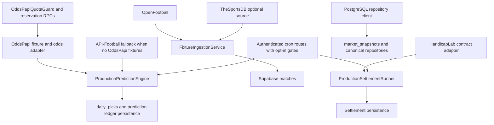

# FiveDollar Phase 0 baseline audit

Audit date: 2026-11-07 (Asia/Jakarta). **PHASE STATUS: BLOCKED. Gate 0: NOT PASSED.**

## Objective and boundary

Establish repository and current production architecture before introducing a provider. This is a source/configuration audit, not a certification of deployed behavior. No application code, credentials, database, scheduler, deployment, or provider settings were changed. No sports-provider request was made.

## Actions performed and evidence

- `git rev-parse --show-toplevel`: `C:/Users/RYZEN/.antigravity-ide/SALMO`.
- Branch `main`, six commits ahead of the locally recorded `origin/main`; no fetch performed, so remote currency is unknown.
- HEAD `5638c28add78d80003f092eaa5583f4aa8ed7abc`, commit time `2026-11-05T10:23:39+07:00`.
- Initial tracked diff empty. Seven pre-existing untracked reports preserved: `API_FOOTBALL_ENVIRONMENT_CREDENTIAL_MAP.md`, `API_FOOTBALL_RECOVERY_PLAN.md`, `API_FOOTBALL_REQUEST_VOLUME_AUDIT.md`, `API_FOOTBALL_ROOT_CAUSE_ANALYSIS.md`, `API_FOOTBALL_SUPPORT_ESCALATION_DRAFT.md`, `API_FOOTBALL_SUSPENSION_FORENSIC_AUDIT.md`, `SALMO_PROVIDER_CONTINUITY_ASSESSMENT.md`.
- Read provider interfaces, environment configuration, prediction discovery, fixture resolution, database boundaries, snapshot repository, CLV implementation, cron routes, workflow definitions, schema declarations and migration inventory. Enumerated research artifacts and tests.
- Read-only Vercel CLI calls: `vercel env ls production`, `vercel ls --environment production`, `vercel inspect https://salmo-1xdsvxdl6-shinerva.vercel.app`, and the JSON inspect variant.
- Linked Vercel project is `shinerva/salmo`. Deployment `dpl_4QZBPyauud9XbCL4BCuzemHWDRZv` is READY, target production, created 2026-11-01 01:07:44 +07:00, with `salmo.dev` and `www.salmo.dev` aliases. Function output includes region `iad1`. READY is deployment status, not evidence of provider or database health.
- JSON inspect returned no `gitSource`, `meta.githubCommitSha`, or `meta.githubCommitRef`. Deployment-to-source equivalence is therefore unverified. The inspected deployment predates local HEAD and November 5 migrations.
- Production environment-name inventory includes OddsPapi, HandicapLab, The Odds API, Dribble, FootyStats, API-Football, Supabase, and cron credentials. Presence does not prove validity or usage. No credential values were retrieved for this audit. Current project environment metadata does not prove the environment captured by an older deployment.
- `FIVEDOLLAR_API_KEY` is absent/empty in `.env.local` and the current process. Explicit staging URL/database/project-ref variables are also absent/empty there. No key fingerprint is applicable. No `.env` modification occurred.

## Observed source architecture

This diagram describes inspected local source. Production deployment source identity, applied database schema, and operational state are not certified.

## Baseline by required area

| Area | Evidence / finding | Limitation |
|---|---|---|
| Provider contracts | `src/services/providers/types.ts`: `IFixtureProvider`, `IOddsProvider`, `ProviderResult`, fixture/odds DTOs | Odds DTO has capturedAt but lacks full requested raw/source/opening/closing provenance |
| OddsPapi | `src/services/providers/oddsPapiProvider.ts`, `src/config/env.ts`; default v4 API, configured bookmakers default to pinnacle,bet365 | Actual subscription/quota/health not probed |
| Other providers | API-Football, The Odds API, OpenFootball, TheSportsDB adapters exist; FootyStats configuration exists | Presence is not active-provider evidence |
| Fixture ingestion | `src/services/fixtureIngestionService.ts`: OpenFootball and optional TheSportsDB; persists via default Supabase client | Must not invoke this persistence path for FiveDollar shadow |
| Canonical identity | `src/lib/fixtureIntegrity.ts`, team alias/rating helpers, production engine deterministic IDs | Multiple ID generation paths need reconciliation before accepting mappings |
| Mapping risk | Ingestion entity key uses league prefix, season, normalized home/away, date; proximity branch accepts first same-team/league candidate within **36 hours** | Proximity branch is not a verified, ambiguity-rejecting FiveDollar mapper; comment says 24 hours but code uses 36 |
| Odds normalization | Provider DTO records market, numeric line, bookmaker, home/away odds and capture time | Cannot represent all requested source timestamps and opening/closing semantics without an isolated richer record |
| Prediction | `src/engine/pipeline/productionPredictionEngine.ts:994`: OddsPapi discovery; line 1116 onward API-Football fallback if no fixtures | Do not execute this engine during evaluation; fallback is real code, irrespective of legacy/test comment |
| Historical research | Local `research/warehouse/*.parquet`, `research/features`, `research/mappings`, `research/raw_dribble`, `data/research` and verification JSONL artifacts exist | File presence only; canonical completeness and DuckDB/LightGBM/MLflow/Optuna runtime were not verified |
| Snapshots | `src/repositories/oddsSnapshotRepository.ts` writes `public.market_snapshots`; defaults missing bookmaker/source to pinnacle/PINNACLE and missing capture time to now | Unsafe to reuse directly for strict FiveDollar provenance; latest lookup filters match+market, not bookmaker+line |
| CLV | `src/engine/clv/clvEngine.ts` uses `oddsTaken * closingNovigProb - 1`, same-line guard | Different from requested raw ratio `signal_odds / closing_odds - 1`; preserve existing engine, implement separate labeled research metric after gates |
| Settlement and ledger | Canonical ledger/repositories, production settlement runner and HandicapLab adapter | No settlement runs or ledger writes performed |
| Environment | `src/config/env.ts`, `src/lib/db.ts`, `src/repositories/dbClient.ts`, `environmentGuard.ts`; `.env*` ignored | Supabase default client can select production credentials; PostgreSQL staging guard requires explicit staging mode; Preview alone is not sufficient isolation |
| Deployment | Local `vercel.json` has `crons: []`; cron routes require ENABLE_PRODUCTION_CRON=true and block Preview for normal production path | Does not prove deployed cron configuration; audit/dry-run branch is separate and must not be invoked casually |
| CI/scheduling | `.github/workflows/ci.yml` runs npm test/build; settle workflow is manual with dry-run/proposal settings | Manual workflow still references provider credentials and account sync; not invoked |
| Tests | 56 files enumerated under tests; fixture, quota, odds batching, temporal integrity, ledger, settlement, staging suites present | Tests not executed in this blocked, documentation-only phase; no pass claim |
| Quota/retry | `src/lib/quota/oddsPapiQuotaGuard.ts`: provider-specific atomic reservation/RPC, reserve/ceiling and failure states; corresponding migration and tests | Not a generic 60/hour limiter. FiveDollar behavior and retry costs remain unknown |

## Declared schemas (not live database introspection)

`data/schema.sql`, `data/schema_canonical.sql`, and migrations declare `matches`, `market_snapshots`, `decisions`, `evidence`, `data_provenance`, `daily_picks`, `prediction_ledger`, settlement-related tables, `daily_prediction_refresh_ledger`, `quota_state`, and `quota_reservations`. Older declarations also include users, entitlements and predictions. The November 5 bootstrap and staging migration introduce/alter canonical tables and policies. These are source declarations, **not proof that production has applied them**. No migration was executed.

## Reuse and required changes if gates later pass

Reuse provider result conventions and pure identity/market helpers only after contract tests establish compatibility. Keep FiveDollar raw payloads and normalized records in a separate local shadow dataset first. Preserve provider IDs, actual bookmaker, exact AH/OU selection and line, source timestamp (nullable if unavailable), capture timestamp and opening/closing roles. Build a dedicated ambiguity-rejecting mapper, independent quota accounting and bounded retries from verified API behavior. Keep raw-ratio CLV separately labeled from existing no-vig CLV. Do not add FiveDollar to production discovery or persistence. These are proposed changes only; no adapter or assumed endpoint was created.

## Files that must not be modified during evaluation

- `src/engine/pipeline/productionPredictionEngine.ts`, `dailyPredictionRefreshService.ts`, `durablePredictionStorageAdapter.ts`.
- `src/engine/settlement/**`, `src/engine/ledger/**`, `src/engine/decision/**`, `src/engine/clv/clvEngine.ts` and model/market thresholds.
- `src/services/providers/oddsPapiProvider.ts`, `apiFootballProvider.ts`, `src/lib/quota/oddsPapiQuotaGuard.ts`, existing provider priority.
- `src/services/fixtureIngestionService.ts`, existing canonical datasets and ledger artifacts under `data/` and `research/`.
- `src/repositories/**`, `src/lib/db.ts`, production schemas/migrations without separately approved migration.
- `src/app/api/cron/**`, `vercel.json`, `.github/workflows/**`, billing/authentication modules and Production environment settings.
- Existing untracked user reports listed above.

Any necessary shared-interface change requires a documented, tested scope decision after API contract verification; none is presently justified.

## Risks, gate decision and next phase

1. **Critical / unresolved:** deployment-to-source identity and applied production schema unknown. Local HEAD is newer than active deployment. Gate 0 cannot certify current production architecture sufficiently.
2. **High / observed:** default database clients, provider fallback and snapshot defaults can violate independent shadow boundaries if reused directly.
3. **High / observed:** missing local FiveDollar key prevents authenticated capability verification even after Gate 0 is resolved.
4. **High / unresolved:** no isolated staging configuration, verified API contract, observations or quota measurements.

**GATE DECISION:** stop dependent phases. **NEXT PHASE:** Phase 1 NOT STARTED. Resolve deployment provenance and provide sanitized read-only applied-schema/environment evidence first; then configure `FIVEDOLLAR_API_KEY` locally (never in chat/source/Production) for Phase 1. Do not deploy local HEAD merely to resolve provenance.

**FILES CREATED:** this report and `FIVEDOLLAR_END_TO_END_EXECUTIVE_REPORT.md`.

**FILES MODIFIED:** none. **TESTS EXECUTED:** none; unit/integration/regression/typecheck/lint/build deferred, no implementation performed. Read-only CLI inspections above completed successfully. An initial PowerShell rg wildcard path failed; repeated schema search with `-g '*.sql'` succeeded.
