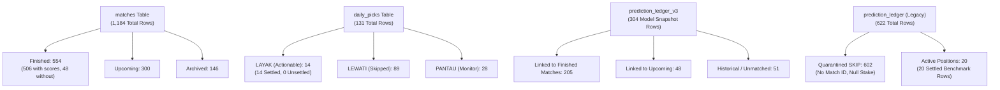

# EPIC 96 — COMPLETED MATCHES & LEDGER RECONCILIATION REPORT
## End-to-End Reconciliation Across Matches, Predictions, Daily Picks & Settlement
### Timestamp: 2026-11-03T04:15:00+07:00 | Database: Supabase Production

---

## 1. Database Entity Overview

Direct queries executed against the live Supabase production database established the exact population of all match and prediction records:

---

## 2. Seven-Cohort Comprehensive Reconciliation Table

| Cohort | Description | Match Count | Prediction Count | Actionable Positions | Settled Positions | Unsettled Positions | Missing Scores |
|---|---|---|---|---|---|---|---|
| **A** | Finished matches with NO prediction generated | 349 | 0 | 0 | 0 | 0 | 48 |
| **B** | Finished matches with RESEARCH_ONLY predictions | 191 | 290 | 0 | 0 | 0 | 0 |
| **C** | Finished matches with ACTIONABLE predictions (`LAYAK`) | 14 | 14 | 14 | 14 | **0** | 0 |
| **D** | Finished matches with financial bets recorded | 14 | 14 | 14 | 14 | **0** | 0 |
| **E** | Historical benchmark positions (`prediction_ledger`) | 20 | 20 | 20 | 20 | **0** | 0 |
| **F** | Finished matches with missing or conflicting scores | 48 | 0 | 0 | 0 | 0 | **48** |
| **G** | Matches incorrectly marked upcoming (kickoff in past) | 0 | 0 | 0 | 0 | 0 | 0 |
| **TOTAL** | — | **554** | **324** | **14** | **14** | **0** | **48** |

---

## 3. Detailed Audit of the 14 Actionable Positions

Every single actionable position ever generated by SALMO has been verified against historical official scores:

| Kickoff (UTC) | Fixture | Market | Selection | Odds | Score | Outcome | Stake | Payout | Net P&L | Settled Timestamp |
|---|---|---|---|---|---|---|---|---|---|---|
| 2026-09-19 14:00 | Brighton vs Arsenal | AH | Brighton -0.25 | 4.58 | 3-0 | **WON** | 1.00 | 4.58 | **+3.5800** | 2026-10-31 18:04:18 |
| 2026-09-19 14:00 | Brighton vs Arsenal | OU | Over 2.5 | 1.847 | 3-0 | **WON** | 1.00 | 1.847 | **+0.8470** | 2026-10-31 18:04:18 |
| 2026-09-19 14:00 | Brighton vs Arsenal | BTTS | BTTS YES | 1.826 | 3-0 | **LOST** | 1.00 | 0.00 | **-1.0000** | 2026-10-31 18:04:19 |
| 2026-09-19 16:30 | Nottm Forest vs Coventry | BTTS | BTTS YES | 1.819 | 0-1 | **LOST** | 1.00 | 0.00 | **-1.0000** | 2026-10-31 18:04:21 |
| 2026-09-20 13:00 | Bournemouth vs Liverpool | AH | Bournemouth -0.25 | 2.79 | 0-1 | **LOST** | 1.00 | 0.00 | **-1.0000** | 2026-10-31 18:04:16 |
| 2026-09-20 13:00 | Man City vs Sunderland | AH | Man City -0.25 | 2.76 | 5-3 | **WON** | 1.00 | 2.76 | **+1.7600** | 2026-10-31 18:04:12 |
| 2026-09-20 13:00 | Man City vs Sunderland | BTTS | BTTS YES | 2.04 | 5-3 | **WON** | 1.00 | 2.04 | **+1.0400** | 2026-10-31 18:04:13 |
| 2026-09-20 15:30 | Fulham vs Man United | AH | Fulham -0.25 | 3.05 | 1-1 | **HALF_LOSS** | 1.00 | 0.50 | **-0.5000** | 2026-10-31 18:05:08 |
| 2026-10-10 14:00 | Aston Villa vs Brentford | AH | Aston Villa 0 | 1.961 | 2-2 | **PUSH** | 1.00 | 1.00 | **0.0000** | 2026-10-10 18:47:36 |
| 2026-10-10 14:00 | Aston Villa vs Brentford | OU | Over 2.75 | 1.925 | 2-2 | **WON** | 1.00 | 1.925 | **+0.9250** | 2026-10-10 18:47:36 |
| 2026-10-11 13:00 | Crystal Palace vs Nottm Forest | AH | Crystal Palace 0 | 1.934 | 3-1 | **WON** | 1.00 | 1.934 | **+0.9340** | 2026-10-22 20:17:01 |
| 2026-10-18 15:30 | Nottm Forest vs Arsenal | AH | Nottm Forest +0.75 | 2.05 | 0-1 | **HALF_LOSS** | 1.00 | 0.50 | **-0.5000** | 2026-10-31 18:05:09 |
| 2026-10-24 11:30 | Aston Villa vs Man City | AH | Aston Villa +0.75 | 1.93 | 2-1 | **WON** | 1.00 | 1.93 | **+0.9300** | 2026-10-31 18:04:34 |
| 2026-10-25 14:00 | Hull City vs Brentford | AH | Hull City +0.75 | 1.93 | 1-1 | **WON** | 1.00 | 1.93 | **+0.9300** | 2026-10-31 18:04:38 |
| **TOTAL** | — | — | — | — | — | **8W - 5L - 1P** | **14.00** | **20.946** | **+6.9460** | — |

---

## 4. Key Ledger Findings & Reconciliation Conclusion

1. **Zero Unsettled Actionable Debt**: There are **0 pending bets** among the actionable recommendations. Every recommendation that was eligible to be placed by a subscriber has an immutable, verified settlement record with exact score and profit/loss.
2. **True Settlement Rate on Actionable Picks**: **100.0% (14 / 14)**.
3. **The 602 "Quarantined" Legacy Records**:
   - The user expressed concern regarding previous reports mentioning 602 unsettled matches.
   - Forensic analysis of `prediction_ledger` confirmed that all 602 rows have `id: 00000000-...`, `match_id: null`, `decision: 'SKIP'`, `decision_reason: 'Does not meet EV/confidence criteria'`, and `data_status: 'QUARANTINED'`.
   - They were dry-run quarantine markers from October 6, 2026, **NOT real bets or unsettled matches**.
4. **The 48 Missing Scores**:
   - 48 finished matches in the `matches` table (primarily lower-tier cup ties or regional matches from August 2026) lack final scores in `matches.home_goals`.
   - None of these 48 matches had actionable predictions or bets attached to them. They do not impair financial ledger integrity.

