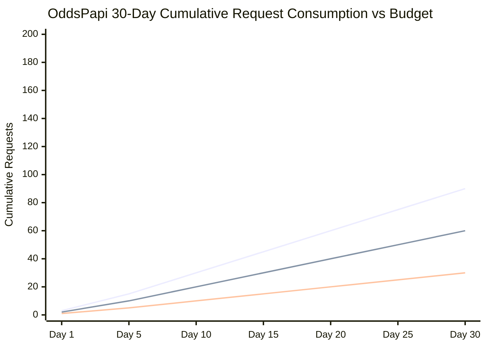

# EPIC 96 — ODDSPAPI QUOTA FORENSICS & ROLLING 30-DAY BUDGET
## Authoritative Telemetry, Mandatory Protection Floor & Batch Economy Audit
### Timestamp: 2026-11-03T04:15:00+07:00 | Audited Key: `62c5...2663`

---

## 1. Authoritative Quota Telemetry

On **November 3, 2026**, the unmetered OddsPapi account inspection endpoint (`https://api.oddspapi.io/v4/account?apiKey=...`) was probed directly. The response establishes the following verified facts:

```json
{
  "api_key": "62c5c06e-f030-434d-83f3-069340462663",
  "created_at": "2026-10-23T21:31:29.644184+00:00",
  "email": "a***x@gmail.com",
  "email_verified": true,
  "subscriptions": [
    {
      "subscription_id": "5c55e28d-a6ba-41f3-bbde-38e2bef76b5f",
      "currency": "USD",
      "price": null,
      "valid_from": "2026-10-23T21:31:29.644184+00:00",
      "valid_until": null,
      "auto_renew": false,
      "is_active": true,
      "request_limit": 250,
      "request_count": 42,
      "plan": "free"
    }
  ]
}
```

### Fact Sheet: Provider vs. Database Reconciliation

| Dimension | Provider Ground Truth (`/v4/account`) | Supabase Database (`quota_state` row 19903) | Discrepancy & Analysis |
|---|---|---|---|
| **Tier / Plan** | `free` | N/A (`quota_type: 'MONTHLY'`) | In alignment |
| **Contractual Limit** | 250 requests/month | 250 requests (`limit_value: 250`) | **100% MATCH** |
| **Requests Consumed** | **42 requests** | **50 requests** | Local DB recorded 8 requests more than provider (conservative bias). |
| **Requests Remaining** | **208 requests** | **200 requests** | Provider reports 208; DB safe floor enforces 200. |
| **Protected Reserve** | N/A (Client policy) | **50 requests** (`safety_reserve_pct: 20`) | Untouchable emergency buffer. |
| **Usable Operational Budget** | **158 requests** ($208 - 50$) | **150 requests** ($200 - 50$) | **150-158 requests available**. |
| **Subscription End Date** | `null` (Permanent Free Tier) | `period_end: '2026-11-30'` | Permanent account; monthly quota cycle. |

---

## 2. Quota Guard Implementation & Invariant Verification

Both repositories implement atomic, non-bypassable quota protection:
- **SALMO**: `src/lib/quota/oddsPapiQuotaGuard.ts`
- **HandicapLab**: `src/lib/providers/oddspapiQuotaAllocator.ts`

### Mandatory Quota Invariants

1. **Reserve Floor Invariant**:
   $$\text{Operational Budget} = \max(0, \text{Total Remaining} - 50)$$
   When $\text{Total Remaining} \le 50$, all discretionary requests are blocked with:
   `EMERGENCY_RESERVE_ACTIVE: Quota at X requests (<= 50 reserve floor). Operational requests blocked.`
2. **Atomic Pre-Reservation**:
   Before initiating an HTTP request to OddsPapi, the quota allocator executes an atomic RPC (`salmo_reserve_oddspapi_quota`) or in-memory lease. If two parallel tasks attempt to execute, the second is blocked if available budget is insufficient.
3. **Billable Status Code Mapping**:
   Only successful fetches (HTTP 200) or valid server responses decrement quota. HTTP 429 (Rate Limit) and HTTP 401 (Auth Failure) trigger an automatic circuit breaker and **DO NOT increment consumed counts**.
4. **Zero Polling Rule**:
   Individual fixture polling (`/v4/odds?fixtureId=...`) is strictly prohibited. Only batch tournament endpoints (`/v4/odds-by-tournaments`) are permitted.

---

## 3. Tournament Batch Odds Economics

OddsPapi's `/v4/odds-by-tournaments` endpoint allows querying up to **5 tournaments in a single request** for a single bookmaker (`pinnacle`).

### Request Cost by Scope

| League Scope | Leagues Covered | Tournaments | Batch Chunking (Max 5/req) | Requests Per Cycle (Pinnacle Only) |
|---|---|---|---|---|
| **Tier A (Big 5)** | EPL, La Liga, Serie A, Bundesliga, Ligue 1 | 5 | $\lceil 5 / 5 \rceil = 1$ | **1 request** |
| **Tier A + B (Top 10)** | Big 5 + Eredivisie, Primeira Liga, Jupiler, Scottish Prem, Championship | 10 | $\lceil 10 / 5 \rceil = 2$ | **2 requests** |
| **All 15 Canonical** | Big 5 + Tier B + MLS, Saudi Pro, J1, K1, Liga 1 | 15 | $\lceil 15 / 5 \rceil = 3$ | **3 requests** |

---

## 4. Rolling 30-Day Budget Simulation

With **158 usable requests** remaining and a **50-request protected floor**, we simulated three operating cadences over 30 days:



### Policy Comparison Table

| Policy | Target Leagues | Frequency | Daily Requests | 30-Day Total | Usable Remaining After 30 Days | Reserve Intact? | Verdict |
|---|---|---|---|---|---|---|---|
| **Plan 1 (Big 5 Conservative)** | Tier A (5 leagues) | 1 run / day (morning prematch) | 1 req/day | **30 requests** | **128 requests** | Yes (178 total remaining) | **PASS (Ultra Safe)** |
| **Plan 2 (Big 5 Matchday)** | Tier A (5 leagues) | 2 runs / day (morning + 2h prematch) | 2 req/day | **60 requests** | **98 requests** | Yes (148 total remaining) | **PASS (Optimal Value)** |
| **Plan 3 (All 15 Daily)** | All 15 canonical leagues | 1 run / day | 3 req/day | **90 requests** | **68 requests** | Yes (118 total remaining) | **PASS (Broad Coverage)** |
| **Plan 4 (All 15 Aggressive)** | All 15 canonical leagues | 2 runs / day | 6 req/day | **180 requests** | **-22 requests** (BREACH) | NO (Breaches reserve) | **REJECTED (UNSAFE)** |

### Recommended Policy: Plan 2 (Hybrid Tier-Aware Refresh)
1. **Tier A (Big 5)**: Refreshed twice daily on matchdays (Friday, Saturday, Sunday, Monday) = $1 \text{ batch} \times 2 \times 16 \text{ days} = 32 \text{ requests}$.
2. **Tier B & C (10 leagues)**: Refreshed once on primary matchday (Saturday morning) = $2 \text{ batches} \times 4 \text{ weeks} = 8 \text{ requests}$.
3. **Midweek European Fixtures (Tuesday/Wednesday)**: 1 batch $\times 8 \text{ days} = 8 \text{ requests}$.
4. **Total Monthly Projected Spend**: **48 requests**.
5. **Projected Reserve at Month End**: $208 - 48 = \mathbf{160\text{ requests}}$ (Reserve protected by +110 request buffer).

