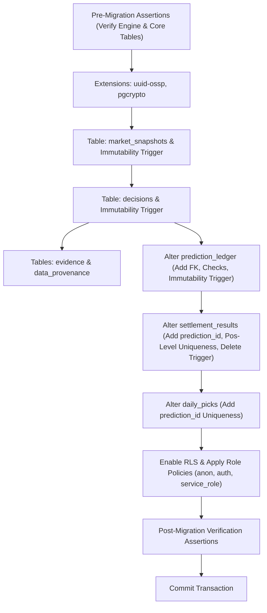

# STAGING DATABASE MIGRATION PLAN

**Document Identifier**: `docs/epic100g/STAGING_MIGRATION_PLAN.md`  
**Parent Epic**: EPIC 100G — Staging Database Migration, Security Parity & Rollback Validation  
**Authors**: Astra / DeepMind Advanced Agentic Coding Pair  
**Status**: COMPLETE / PREPARED & TESTED LOCALLY  
**Execution Status**: HELD (Awaiting Dedicated Staging Project Provisioning)  
**Production Status**: STRICTLY NO-GO  

---

## 1. Executive Summary

This plan outlines the procedure for migrating the canonical database contract (`data/schema_canonical.sql`) to a dedicated staging Supabase environment.

The migration is:
1. **Fully Transactional**: Enclosed within a single `BEGIN ... COMMIT` block. Any assertion failure or syntax defect automatically triggers a complete rollback without leaving partial objects.
2. **Idempotent**: Safe to re-run multiple times without failure or corrupting existing records.
3. **Non-Destructive**: Does not drop, truncate, or overwrite pre-existing tables (`matches`, `prediction_ledger`, `settlement_results`, `daily_picks`).
4. **Tested Locally**: The complete migration and rollback cycle was tested against PostgreSQL 16.15 (`salmo_test`) with 100% success.

---

## 2. Migration Dependency Graph (DAG)

---

## 3. Step-by-Step Execution Sequence

### Phase 1: Pre-Flight Assertions
The migration executes a PL/pgSQL assertion block before making any schema changes:
- Asserts that target engine is PostgreSQL 15+ or 16+.
- Asserts that pre-existing core tables `matches`, `prediction_ledger`, and `settlement_results` exist.
- If any assertion fails, the transaction aborts immediately with `RAISE EXCEPTION`.

### Phase 2: Schema Object Creation
1. **`market_snapshots`**: Point-in-time immutable odds quotes from sharp bookmakers (Pinnacle). Includes odds check constraint (`chk_market_snapshots_odds: home_odds > 1.0 AND away_odds > 1.0`) and trigger `trg_immutable_market_snapshots`.
2. **`decisions`**: Immutable evaluations generated by ValueEngine. Includes probability check constraint (`chk_decisions_prob: model_prob_pct BETWEEN 0 AND 100`) and trigger `trg_immutable_decisions`.
3. **`evidence` and `data_provenance`**: Cryptographic provenance hashes, sample sizes, and backtest checksums.

### Phase 3: Contract Refactoring on Existing Tables
1. **`prediction_ledger`**:
   - Adds nullable FK `decision_id REFERENCES decisions(id) ON DELETE RESTRICT`.
   - Attaches `chk_ledger_prob`, `chk_ledger_odds`, `chk_ledger_result_status`.
   - Creates unique index `uq_prediction_ledger_doi ON (doi_id)`.
   - Attaches trigger `trg_immutable_prediction_ledger`, which prevents mutation of odds, probabilities, lines, selection, and hashes, while permitting settlement updates to `result_status`, `roi`, `profit_loss`, and `settled_at`.
2. **`settlement_results`**:
   - Adds dual-compatibility column `prediction_id VARCHAR(255)`.
   - Drops obsolete market-level constraint `uq_settlement_fixture_market`.
   - Establishes position-level unique constraint `uq_settlement_ledger_pos UNIQUE (ledger_position_id)`.
   - Attaches trigger `trg_immutable_settlement_results` preventing row deletions.
3. **`daily_picks`**:
   - Ensures `prediction_id` exists.
   - Refactors uniqueness to `uq_daily_picks_prediction UNIQUE (prediction_id)`, allowing multiple lines on the same match to coexist.

### Phase 4: Security Hardening (RLS & Grants)
1. Enables Row-Level Security on all 6 tables.
2. Configures `anon` policy: read-only access to active/settled `daily_picks` and public fixtures; zero write permissions.
3. Configures `authenticated` policy: read-only access to active `prediction_ledger` and `daily_picks`; zero write permissions.
4. Configures `service_role` policy: full operational access for trusted backend workers.

### Phase 5: Post-Flight Verification
Executes automated validation queries:
- Confirms `market_snapshots` and `decisions` exist in `information_schema.tables`.
- Confirms triggers `trg_immutable_market_snapshots`, `trg_immutable_decisions`, `trg_immutable_prediction_ledger`, and `trg_immutable_settlement_results` are active in `pg_trigger`.
- If any check fails, transaction rolls back automatically.

---

## 4. Rollback Plan & Safety Limits

The rollback script is defined in `STAGING_ROLLBACK.sql` and `data/migrations/20261105_epic100g_staging_canonical_migration_rollback.sql`.

### Rollback Guarantees:
- **Zero Loss of Historical Data**: `matches`, `prediction_ledger`, `settlement_results`, and `daily_picks` are **NEVER** dropped during rollback.
- **Trigger Removal**: Cleanly drops all custom PL/pgSQL triggers and functions.
- **Object Cleanup**: Safely drops candidate tables `decisions`, `market_snapshots`, `evidence`, and `data_provenance` with `CASCADE`.
- **Constraint Relaxation**: Safely drops newly added foreign keys and checks without failing on existing data.

---

## 5. Deployment Authorization Status

> [!CAUTION]
> In accordance with EPIC 100G safety instructions, this migration has **NOT** been executed against the remote Supabase endpoint (`rgkrfzxipkrwqccfuqfq.supabase.co`), which is the LIVE PRODUCTION instance.
> 
> **Execution Status**: PENDING PROVISIONING OF SEPARATE STAGING SUPABASE PROJECT.
