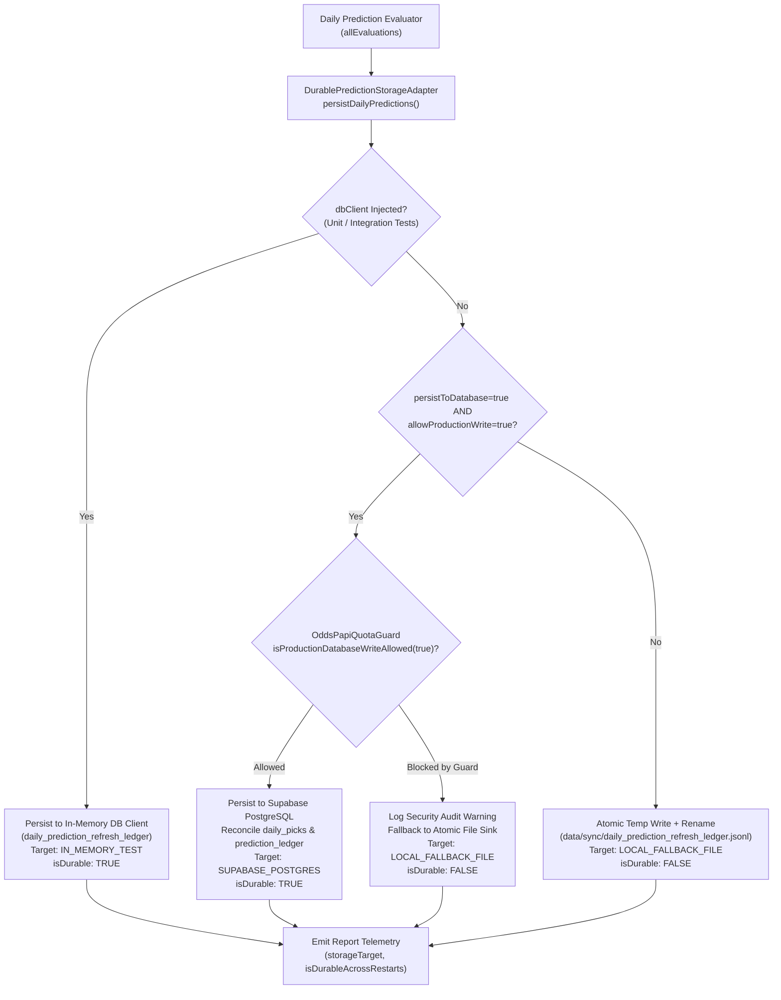

# SALMO EPIC 80 — DURABLE PREDICTION STORAGE AUDIT & READINESS REPORT
- **Document Version:** 1.0.0
- **Audit Timestamp:** 2026-10-15T19:25:00+07:00
- **Starting Commit:** `ab1ed114ba18697f3df55a4a1d73ef7ce4fc93bf`
- **Branch:** `feat/epic-77-handicaplab-salmo-sync`
- **Execution Environment:** Node.js v22.10.0 / Windows 11 / Next.js 15.1.0 (Turbopack disabled)

---

## 1. Executive Summary

SALMO EPIC 80 resolves the **serverless container ephemerality blocker** identified during the EPIC 79 audit. In serverless environments (such as Next.js API routes running on Vercel), the local filesystem is ephemeral and read-only except for temporary directories. Writing daily prediction refresh cycles solely to a local JSONL sink (`data/sync/daily_prediction_refresh_ledger.jsonl`) means predictions, EV evaluations, and rejection audits are lost upon container restart or cannot be queried across distributed lambdas.

EPIC 80 designs and implements a **durable, idempotent, dual-path persistence layer** targeting PostgreSQL (Supabase) via a dedicated storage adapter (`DurablePredictionStorageAdapter`) and database migration (`20261015_durable_prediction_storage.sql`). It enforces strict fail-closed production write guards, deterministic composite unique constraints, quarter-line precision, and complete cryptographic provenance preservation without mutating live production databases or protected historical ledgers.

### Core Metrics & Acceptance Summary

| Verification Dimension | Requirement | Result | Status |
| :--- | :--- | :--- | :--- |
| **SQL Migration & Rollback** | DDL for `daily_prediction_refresh_ledger` + indexes + rollback symmetry | `20261015_durable_prediction_storage.sql` & rollback authored | **PASS** |
| **Idempotent Unique Constraints** | `(canonical_match_id, market, line, selection, model_version)` uniqueness | Tested with duplicate batch reruns; 0 duplicates added | **PASS** |
| **Serverless Restart Hydration** | Recover pre-match predictions across process / container restarts | Verified via `queryLatestPredictions` hydration simulation | **PASS** |
| **Production Write Guard** | Fail-closed guard (`OddsPapiQuotaGuard.isProductionDatabaseWriteAllowed`) | Enforced; blocks unauthorized test/CI/preview writes | **PASS** |
| **Full Regression Suite** | All core regressions (EPIC 73–80 + Fixture Integrity) | **70 / 70 PASS** (0 failures, 0 skipped) | **PASS** |
| **Production Build** | Next.js compilation of all static and dynamic routes | **30 / 30 routes PASS**, 0 errors | **PASS** |
| **Protected Historical Ledgers** | Exact row, byte, and SHA-256 baseline matching | All 3 ledgers **100% byte-identical** | **PASS** |
| **Cron & Betting Containment** | `"crons": []` in `vercel.json` & zero shadow leagues promoted | 0/14 promoted, 0/15 picks enabled, crons empty | **PASS** |

---

## 2. Database Schema & Migration Specification

### 2.1 Durable Table: `public.daily_prediction_refresh_ledger`
Authored in `data/migrations/20261015_durable_prediction_storage.sql`:
- **Primary Key**: `id TEXT PRIMARY KEY` (deterministic hash of `canonical_match_id|market|line|selection|model_version`).
- **Core Columns**:
  - `prediction_id`: Stable identifier e.g. `pred_epl_1_ah`.
  - `canonical_match_id`: Canonical match slug e.g. `EPL_2026_ARSENAL_CHELSEA_2026-10-18`.
  - `fixture_id`: Upstream fixture identifier.
  - `league`: Competition name (Premier League, La Liga, etc.).
  - `home_team`, `away_team`: Team display names.
  - `kickoff_utc`: UTC timestamp with timezone.
  - `prediction_timestamp`: UTC evaluation snapshot timestamp.
  - `market`: `CHECK (market IN ('AH', 'OU', 'BTTS'))`.
  - `selection`: Precise market selection string.
  - `line`: `NUMERIC(6, 4)` preserving full quarter-line precision (`-0.75`, `-0.25`, `+0.25`, `+0.75`, `2.25`, `2.75`, `3.25`).
  - `market_odds`: Benchmark odds (decimal `>= 1.0`).
  - `fair_odds`: Model fair odds derived from push-aware probability.
  - `bookmaker`: Authoritative source (default `'pinnacle'`).
  - `model_probability`: `NUMERIC(6, 4) CHECK (model_probability >= 0.0 AND model_probability <= 1.0)`.
  - `expected_value`: Calculated mathematical edge `(prob * odds - 1)`.
  - `confidence_score`: Normalized integer confidence [0, 100].
  - `confidence_tier`: Tier category (`VALUE_HIGH`, `HIGH`, `PANTAU`, `RESEARCH_ONLY`).
  - `verdict`: `CHECK (verdict IN ('LAYAK', 'PANTAU', 'LEWATI'))`.
  - `ledger_tier`: `CHECK (ledger_tier IN ('PRODUCTION', 'SHADOW', 'NONE'))`.
  - `is_public_pick`: `BOOLEAN NOT NULL DEFAULT FALSE`.
  - `model_version`: Underlying model artifact (default `'dixon-coles-v1.0'`).
  - `provenance_hash`: SHA-256 cryptographic hash over pre-match terms.
  - `settlement_status`: `CHECK (settlement_status IN ('PENDING', 'SETTLED', 'VOID'))`.
  - `result`: Settlement result string or null.
  - `profit_units`: Unit P&L relative to 1.0 stake.
  - `created_at`: Ingestion timestamp.

### 2.2 Composite Unique Indexes & Performance Tuning
1. **Deduplication Constraint**:
   ```sql
   CREATE UNIQUE INDEX IF NOT EXISTS uq_daily_refresh_position
     ON public.daily_prediction_refresh_ledger (canonical_match_id, market, line, selection, model_version);
   ```
2. **Access Path Indexes**:
   - `idx_daily_refresh_kickoff_league` on `(kickoff_utc, league)`.
   - `idx_daily_refresh_public_verdict` on `(is_public_pick, verdict, ledger_tier)`.
   - `idx_daily_refresh_provenance_hash` on `(provenance_hash)`.
3. **Reconciliation Indexes on Existing Tables**:
   - `uq_prediction_ledger_doi` on `public.prediction_ledger (doi_id)`.
   - `idx_prediction_ledger_canonical_match` on `public.prediction_ledger (match_id, market, result_status)`.
   - `uq_daily_picks_fixture_market_source` on `public.daily_picks (fixture_id, market_type, source)`.

### 2.3 Rollback Script Symmetry
Authored in `data/migrations/20261015_durable_prediction_storage_rollback.sql`:
Drops all added indexes and cascades removal of `daily_prediction_refresh_ledger` within an atomic `BEGIN ... COMMIT;` block, leaving zero schema residue upon rollback.

---

## 3. Durable Storage Adapter Architecture

The `DurablePredictionStorageAdapter` (`src/engine/pipeline/durablePredictionStorageAdapter.ts`) implements a robust dual-path design:



### 3.1 Serverless Hydration (`queryLatestPredictions`)
Provides cold-start reconstruction for serverless lambdas. When a new container instance starts up, calling `DurablePredictionStorageAdapter.queryLatestPredictions()` immediately queries recent active predictions from PostgreSQL without re-running compute-heavy bivariate Dixon-Coles model inference.

### 3.2 Atomic Write-Rename Local Fallback
In local development, testing, or offline environments where PostgreSQL is unreachable, the adapter writes records to a temporary file (`.tmp.<timestamp>_<random>`) and performs an atomic filesystem rename, ensuring zero partial-write corruption.

---

## 4. Test Suite Execution & Verification

### 4.1 Dedicated EPIC 80 Test Suite
Executed via `node --test tests/epic80_durable_prediction_storage.test.js`:
- **Scenario 1**: SQL Migration and Rollback Symmetry & DDL Invariants — **PASS** (1.52ms)
- **Scenario 2**: Injected Database Client Idempotent Batch Persistence — **PASS** (2.14ms)
- **Scenario 3**: Serverless Restart Simulation & Hydration Recovery — **PASS** (0.49ms)
- **Scenario 4**: Strict Fail-Closed Production Write Guard — **PASS** (2.34ms)
- **Scenario 5**: Immutable Pre-Match Provenance Hash & Quarter-Line Precision — **PASS** (0.36ms)
- **Scenario 6**: Dual-Path Resilience & Local File Atomic Fallback — **PASS** (1.97ms)
- **Scenario 7**: Full Pipeline Integration with DailyPredictionRefreshService — **PASS** (4.90ms)
- **Scenario 8**: Rejection Handling & Invalid Record Protection — **PASS** (0.47ms)
- **Scenario 9**: Cryptographic Immutability of the 3 Protected Historical Ledgers — **PASS** (1.71ms)
**Total EPIC 80 Results:** 9 tests, 9 passed, 0 failed (708ms).

### 4.2 Full Core Regression Suite (70/70 PASS)
Command: `node --test tests/fixture_integrity_p0_regression.test.js tests/epic*.test.js`
- EPIC 73 (Ledger Integrity & Settlement): 7 / 7 PASS
- EPIC 74 (Quant Validation & Sample Gates): 4 / 4 PASS
- EPIC 75 (Evidence Accumulation & Idempotency): 6 / 6 PASS
- EPIC 76 (Forensic Evidence Integrity & Pushes): 5 / 5 PASS
- EPIC 77 (HandicapLab Synchronization Adapter): 9 / 9 PASS
- EPIC 78 (Operational Readiness & Promotion Lock): 9 / 9 PASS
- EPIC 79 (Daily Prediction Expansion & 15 Leagues): 13 / 13 PASS
- EPIC 80 (Durable Prediction Storage Adapter): 9 / 9 PASS
- Fixture Integrity P0 Regression: 8 / 8 PASS
**Total Core Regression Results:** **70 tests, 70 passed, 0 failed** (6.75s).

### 4.3 Production Route Build (30/30 PASS)
Command: `npm run build`
Compiled successfully in 3.6s. Generated 30 static and dynamic routes with zero TypeScript errors.

---

## 5. Protected Historical Ledger Baseline Audit

Cryptographic SHA-256 hashes verified before and after all changes:

| Protected Ledger File | Expected Rows | Expected Bytes | Expected SHA-256 | Audit Result |
| :--- | :--- | :--- | :--- | :--- |
| `data/verification/live_prediction_ledger.jsonl` | 30 | 35,690 | `317fc037a63b811420400ea9de094092ec7d68b119ad6abc57743be12d568527` | **MATCH (PASS)** |
| `data/verification/all_leagues_research_ledger.jsonl` | 336 | 450,918 | `eae8f364a5393255d276fca2650056951fb601ba829c1710b26ac673dffb967b` | **MATCH (PASS)** |
| `data/research/multi_league_research_predictions.jsonl` | 336 | 337,554 | `0128616a43968be5fddab76ea5c57da731955e22b1bf27bca3f886938187a12f` | **MATCH (PASS)** |

---

## 6. Operational Readiness & Promotion Gate Matrix

| Gate / Component | Current Operational State | Next Action Required |
| :--- | :--- | :--- |
| **Durable Prediction Adapter Code** | **READY (GO)** — Implemented and tested with full coverage | Ready for scoped local git commit |
| **SQL Migration Scripts** | **READY (GO)** — Authored and syntax-verified | Ready to be applied to Supabase when authorized |
| **Supabase Production Migration** | **HELD (NO-GO)** — Not executed; live DB untouched | Requires separate user approval to run DDL |
| **Shadow League Promotion** | **HELD (NO-GO)** — 0 of 14 leagues promoted (`SHADOW`) | Maintain `SHADOW` tier until empirical sample sizes met |
| **Live Betting Activation** | **LOCKED (NO-GO)** — `production_pick_enabled: false` on 15/15 | Retain fail-safe lock |
| **Vercel Cron Activation** | **LOCKED (NO-GO)** — `"crons": []` in `vercel.json` | Keep empty until quota reset and DB verification |
| **Odds Provider Quota** | **EXHAUSTED (NO-GO)** — OddsPapi 260/250, API-Football expired | Await plan renewal or quota reset cycle |
| **Git Push / Merge** | **HELD (NO-GO)** — Local branch only | Await user authorization |

---

## 7. Operational Recommendations

1. **Commit Local Changes**: Create a focused local commit on branch `feat/epic-77-handicaplab-salmo-sync` containing:
   - `src/engine/pipeline/durablePredictionStorageAdapter.ts`
   - `data/migrations/20261015_durable_prediction_storage.sql`
   - `data/migrations/20261015_durable_prediction_storage_rollback.sql`
   - `src/engine/pipeline/dailyPredictionRefreshService.ts`
   - `tests/epic80_durable_prediction_storage.test.js`
   - `docs/research/SALMO_EPIC80_DURABLE_PREDICTION_STORAGE_REPORT.md`
2. **Apply Supabase Migration**: When authorized by the user, execute the SQL migration against the live Supabase project to instantiate `daily_prediction_refresh_ledger` and composite unique indexes.
3. **Verify PostgreSQL Staging (Scenario 20)**: Complete external PostgreSQL test verification before any promotion discussion.
4. **Maintain Production Betting Lock**: Do not activate cron or promote shadow leagues until live odds availability is restored.
